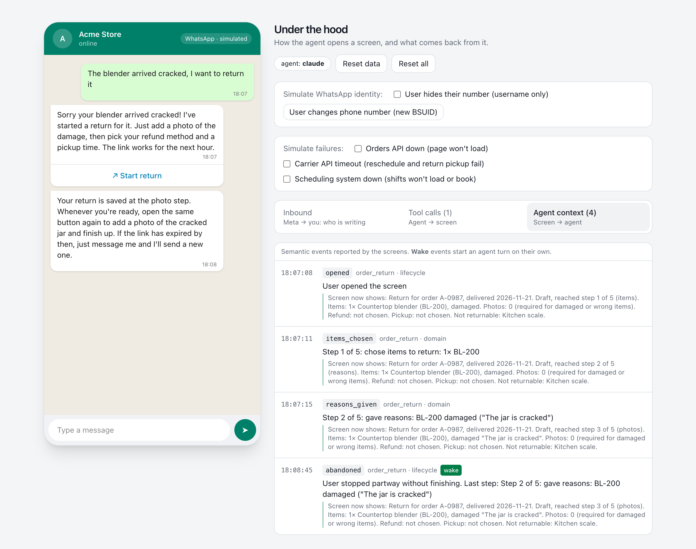

# ui-calling

**Send a screen from any chat. Your agent hears what happens on it.**

> **Preview.** Not on npm yet and not ready for production; the API may still change. MIT licensed and self-hosted: it runs in your app, not on someone else's platform.

Your agent is talking to a customer on WhatsApp. To process a return it needs the items, a reason for each, photos and a pickup slot, and chat is bad at all four. So it calls `show_order_return({ order_id })` like any other tool. The customer gets a link and opens a real screen. They pick the items, give a reason, and stop before the photos. Fifteen minutes later the agent reads (how long to wait is yours to set with `abandonAfterMs`; it's off until you set it, and the demo uses 90 seconds):

```
08:20:11 [order_return] opened: User opened the screen
08:20:40 [order_return] items_chosen: Step 1 of 5:
         chose items to return: 1× BL-200
08:21:02 [order_return] reasons_given: Step 2 of 5:
         gave reasons: BL-200 damaged ("jar cracked")
08:36:02 [order_return] abandoned: User stopped partway
         without finishing. Last step: Step 2 of 5
```

It writes back in the chat: "Want to send the photos later? The link keeps your progress." Reopening the link starts at the photos.



That's ui-calling. The screen a tool opens is a *surface*: a link that works in any channel (WhatsApp, SMS, email, a web chat), and its whole life comes back into the agent's context (opened, left, came back, each action and its outcome, errors, completed, abandoned). It works with Anthropic, OpenAI, the AI SDK and MCP. Screens are React, copied into your repo, and it's self-hosted.

Most events are just recorded for the agent's next turn. The ones that matter (a finished task, an abandon, a failure) **wake** the agent: they start a turn on their own, so it can write first, as in the return above.

```
agent ──tool call──▶ show_order_status({ order_id })
                        │  session: opaque token, bound to conversation + subject, expires
                        ▼
chat  ◀── "Here's your order 👇" + [View order] button
                        │
user opens link ──▶ data resolved server-side, scoped to the subject
                        │
user acts ──▶ "User rescheduled the delivery to 2026-11-27, 16:00–20:00"  (wake)
                        ▼
agent follows up in the chat: "Done ✅ …"
```

## Why ui-calling

Other tools let a bot open screens. ui-calling lets your agent know what happens on them.

- **The agent decides to open a screen,** the way it calls a function, in the middle of any conversation. There's no predesigned flow.
- **Events cover the screen's whole life,** written for the model to read, not one result on close.
- **Users who stall get noticed.** An `abandoned` event wakes the agent and names where they stopped (`abandonAfterMs`).
- **Failures are explained, not lost.** When an API is down or the slot is gone, the agent learns what the user tried and why it failed, and can say so in the chat.
- **The agent never answers blind.** `summarize` tells it what the user is looking at.
- **Typed end to end.** One `defineSurface` is the tool schema, the server's validation and the screen's types.
- **No new platform.** It plugs into the agent you have, and the screens are yours, copied into your project as source you own and can edit (the way shadcn/ui works), not installed as a dependency.

Automation tools count the conversations they handled. ui-calling is for the ones that would otherwise be lost: the user who stopped halfway, the payment that failed, the slot that disappeared.

## How it compares

| Use | When |
|---|---|
| MCP Apps, or the AI SDK's tool parts | The user is already in a client that renders UI inline: Claude, ChatGPT, your own web chat |
| WhatsApp Flows | A short form whose fields you know in advance; it never leaves WhatsApp |
| LangGraph interrupts, or a durable workflow engine | You need to pause and resume an agent, with no screen of your own |
| **ui-calling** | The user is in a channel that can only carry a link, the screen is your own, and what happens on it (a stall, a failure, partial progress) should change what the agent says next |

They combine: a ui-calling event can resume a paused workflow, and a surface is just a page, so it can also open from a web chat.

## When not to use it

- **A short, fixed form** (a lead, a three-question survey): a native form or reply buttons keep the user in the chat. A link asks them to trust a page.
- **Read-only status:** a text reply is enough. A screen earns its place when the user can act on it.
- **Open-ended support:** the conversation is the interface, and there's no outcome for a screen to report.
- **A quick yes or no:** reply buttons beat opening a page.

## What you can build

The fit is a task that is hard in chat (uploads, live availability, a long list, a third-party SDK) and where stalling or failing matters to the follow-up. These four run today, in the demo or as blocks you copy:

| Use case | What the screen does | In this repo |
|---|---|---|
| Returns and exchanges | Items, a reason each, photos, refund and pickup | Demo surface (`order_return`) |
| Delivery reschedule | Live slots, "that slot is gone", carrier outages | Block: `order-status` |
| Account linking | Verify an email code, link the chat to a customer | Block: `link-account` |
| Shift picking | Open shifts that others may take first | Demo surface (`shift_picker`) |

The same pieces fit insurance claim intake (the return's steps and photo upload), identity verification (abandon at the selfie), appointment booking across locations, and B2B reorders (`quantity-stepper`, `choice-card`).

## Try the demo

A hosted demo is on the roadmap; for now it runs from a clone, with no API key needed:

```bash
git clone https://github.com/pausanchez/ui-calling && cd ui-calling && npm install
```

```bash
npm run dev
```

Open http://localhost:5173 and ask "¿Dónde está mi pedido?", "The blender arrived cracked, I want to return it" (a five-step return with photo upload) or "Are there any shifts open this week?". It's a simulated WhatsApp chat next to an "Under the hood" panel with two tabs:
- **Tool calls** (agent → screen): the tool definitions the model gets, then for each call the params the model passed, what `ui.runTool()` returned, the `tool_result` sent back, and the WhatsApp Cloud API request that would deliver the link.
- **Agent context** (screen → agent): the events coming back from the screen, with what it showed after each one.

- With `ANTHROPIC_API_KEY` set, the agent is Claude (`claude-opus-5-5`) using the generated tool schemas.
- Without it, a scripted agent runs the same loop, so the demo works offline. Force either with `AGENT=claude|scripted`.
- `ABANDON_AFTER_MS` (default 90000) controls when an opened-but-untouched screen wakes the agent.
- `npm install` may warn about unapproved install scripts (esbuild, fsevents); it still works.

**Reset data** puts orders, returns and shifts back to the start and keeps chats and account links. **Reset all** clears everything, real WhatsApp chats included.

It can also answer a real WhatsApp number: see [Getting started](docs/getting-started.md#run-the-demo-on-your-own-whatsapp).

## Get started

Install the preview, set it up in your app and generate your first screen:

```bash
npx ui-calling init
npx ui-calling new shift-picker
```

[Getting started](docs/getting-started.md) has the install command, what `init` writes for Next.js, Vite, React Router and Express, the packages, and the three primitives (contract, implementation, screen). [GUIDE.md](packages/cli/GUIDE.md) has the patterns and rules, written so coding agents can follow them too.

## Errors reach the agent too

When something behind the screen fails, the agent hears about it as an `error` event. It never claims an action happened, and it can pick up the conversation from there.

| Source | How it's caught | Example |
|---|---|---|
| `load` | `resolve` throws when the page opens | Orders API returns 503 |
| `action` | An event handler throws; includes what the user tried | Carrier API times out while rescheduling |
| `client` | `reportError(err, context)` from `useSurface()` | A maps or payments SDK fails in the browser |
| `render` | Built-in error boundary in `<SurfaceProvider>` | A component crashes |

```ts
throw new SurfaceError("carrier_timeout", "Carrier API timed out after 10s", { retryable: true });
```

- Throw `SurfaceError` for failures you expect. Its code and message go to the agent as written, so keep them free of secrets. Other errors go through `describeError`. By default the agent gets a generic `unexpected` error and the real one is only logged on your server, since raw messages can carry secrets.
- The first error of each kind in a session wakes the agent. Retries are still recorded, but they don't trigger a new message (`wakeOnError: false` turns waking off).
- The screen shows the user a generic message in their language, never the upstream error.

The demo has switches in the side panel to simulate both outages.

## Security, in short

- The link carries only a random token; the server keeps its hash. Data is resolved when the page opens, scoped to the user the link was sent to.
- Events reach the agent marked as user data, not instructions, and fields like codes and passwords are never shown to it.
- Links expire, close once the user finishes, and can be bound to one device.
- A link can wake the agent only a few times a minute.

The whole model, plus persistence, languages and WhatsApp identity: [GUIDE.md](packages/cli/GUIDE.md#security-model).

## Roadmap

- A hosted demo with the scripted agent, so you can try it without cloning
- Step-up verification for sensitive surfaces (WhatsApp authentication templates cannot be sent to a BSUID, the anonymous user ID WhatsApp gives a business, so it needs another channel)
- A Postgres store for hosts without a lasting disk (serverless); `UiStore` is the interface to implement
- A send helper for the WhatsApp Cloud API (`whatsappCtaMessage` builds the payload; the demo sends it, see GUIDE.md)
- Live, model-backed tests for the adapters (they're tested in-process; the Anthropic one also runs in the demo, and the AI SDK and OpenAI ones ran in pilots)
- More blocks: payslip viewer, document signing, availability calendar (today: `order-status` and `link-account`; a shift picker and a multistep return with photo upload exist in the demo)
- A PIN step before a sensitive screen shows its data (`bindToDevice` already stops a forwarded link from working on another device)
- More languages in the blocks (en and es today)

## License

MIT. See [LICENSE](LICENSE).
