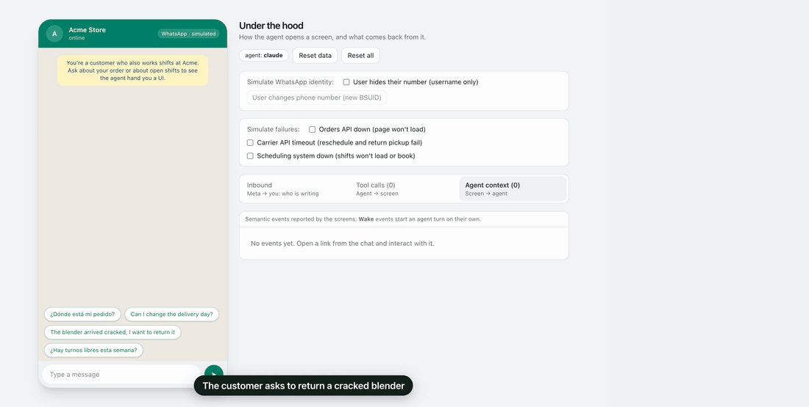

# ui-calling

**Send a screen from any chat. Your agent hears what happens on it.**

Built for the conversations that would otherwise be lost: the user who stops halfway, the payment that fails, the slot that disappears.

> **Preview.** Not on npm yet and not ready for production; the API may still change. MIT licensed and self-hosted: it runs in your app, not on someone else's platform.



Your agent is talking to a customer on WhatsApp. To process a return it needs the items, a reason for each, photos and a pickup slot, and chat is bad at all four. So it calls `show_order_return({ order_id })` like any other tool. The customer gets a link and opens a real screen. They pick the items, give a reason, and stop before the photos. Fifteen minutes later the agent reads:

```
08:20:11 [order_return] opened: User opened the screen
08:20:40 [order_return] items_chosen: Step 1 of 5:
         chose items to return: 1× BL-200
08:21:02 [order_return] reasons_given: Step 2 of 5:
         gave reasons: BL-200 damaged ("jar cracked")
08:36:02 [order_return] abandoned: User stopped partway
         without finishing. Last step: Step 2 of 5
```

It writes back in the chat: "Want to send the photos later? Your progress is saved." The link, or a new one once it expires, opens at the photos. (Abandon is opt-in: nothing wakes the agent until you set `abandonAfterMs`.)

That's ui-calling: tool calling lets an agent call your functions, ui-calling lets it call a screen. A screen's link works in any channel (WhatsApp, SMS, email, a web chat), and its whole life comes back into the agent's context (opened, left, came back, each action and its outcome, errors, completed, abandoned). It works with Anthropic, OpenAI, the AI SDK and MCP. Screens are React, copied into your repo, and it's self-hosted.

Most events are just recorded for the agent's next turn. The ones that matter (a finished task, an abandon, a failure) **wake** the agent: they start a turn on their own, so it can write first, as in the return above. When a follow-up wouldn't help, the agent calls the built-in `stay_silent` tool instead of writing, and `ui.onSilentWake` counts those turns, so you can see which screens wake it for nothing.

```
agent ──tool call──▶ show_order_return({ order_id })
                        │  link: opaque token, bound to this conversation
                        │  and this user, expires
                        ▼
chat  ◀── "Let's start your return 👇" + [Start return] button
                        │
user opens link ──▶ data loaded on the server, only what this user may see
                        │
user picks items, gives a reason ──▶ recorded quietly, step by step
                        │
15 minutes idle ──▶ "User stopped partway… Step 2 of 5"  (wake)
                        ▼
agent writes first: "Want to send the photos later?"
```

## Why ui-calling

Other tools let a bot open screens. ui-calling lets your agent know what happens on them.

- **The agent decides to open a screen,** the way it calls a function, in the middle of any conversation. There's no predesigned flow.
- **Events cover the screen's whole life,** written for the model to read, not one result on close.
- **Users who stall get noticed.** An `abandoned` event wakes the agent and names where they stopped (`abandonAfterMs`).
- **Failures are explained, not lost.** When an API is down or the slot is gone, the agent learns what the user tried and why it failed, and can say so in the chat.
- **The agent never answers blind.** `summarize` tells it what the user is looking at.
- **Typed end to end.** One `defineSurface` is the tool schema, the server's validation and the screen's types.
- **No new platform.** It plugs into the agent you have, and the screens are yours, copied into your project as source you own and can edit (the way shadcn/ui works), not installed as a dependency.

## How it compares

| Use | When |
|---|---|
| MCP Apps, or the AI SDK's tool parts | The user is already in a client that renders UI inline: Claude, ChatGPT, your own web chat |
| WhatsApp Flows | A short form whose fields you know in advance; it never leaves WhatsApp |
| LangGraph interrupts, or a durable workflow engine | You need to pause and resume an agent, with no screen of your own |
| **ui-calling** | The user is in a channel that can only carry a link, the screen is your own, and what happens on it (a stall, a failure, partial progress) should change what the agent says next |

They combine: a ui-calling event can resume a paused workflow, and a screen is just a page, so it can also open from a web chat.

## When not to use it

- **A short, fixed form** (a lead, a three-question survey): a native form or reply buttons keep the user in the chat. A link asks them to trust a page.
- **Read-only status:** a text reply is enough. A screen earns its place when the user can act on it.
- **Open-ended support:** the conversation is the interface, and there's no outcome for a screen to report.
- **A quick yes or no:** reply buttons beat opening a page.

## What you can build

The fit is a task that is hard in chat (uploads, live availability, a long list, a third-party SDK) and where stalling or failing matters to the follow-up. These four run today, in the demo or as ready-made screens you copy into your project:

| Use case | What the screen does | In this repo |
|---|---|---|
| Returns and exchanges | Items, a reason each, photos, refund and pickup | Demo (`order_return`) |
| Delivery reschedule | Live slots, "that slot is gone", carrier outages | Ready-made: `order-status` |
| Account linking | Verify an email code, link the chat to a customer | Ready-made: `link-account` |
| Shift picking | Open shifts that others may take first | Demo (`shift_picker`) |

The same pieces fit insurance claim intake (the return's steps and photo upload), identity verification (abandon at the selfie), appointment booking across locations, and B2B reorders (`quantity-stepper`, `choice-card`).

## Try the demo

A hosted demo is on the roadmap; for now it runs from a clone, with no API key needed:

```bash
git clone https://github.com/pausanchez/ui-calling && cd ui-calling && npm install
```

```bash
npm run dev
```

Open http://localhost:5173 and ask "¿Dónde está mi pedido?", "The blender arrived cracked, I want to return it" (a five-step return with photo upload) or "Are there any shifts open this week?". It's a simulated WhatsApp chat next to an "Under the hood" panel with two tabs:
- **Tool calls** (agent → screen): the tool definitions the model gets, then for each call the params the model passed, what `ui.runTool()` returned, the `tool_result` sent back, and the WhatsApp Cloud API request that would deliver the link.
- **Agent context** (screen → agent): the events coming back from the screen, with what it showed after each one.

No API key? A scripted agent runs the same loop. Options, resets and running it on a real WhatsApp number: [Getting started](docs/getting-started.md#running-the-demo).

## Get started

First install the preview: it's not on npm yet, so the [install command in Getting started](docs/getting-started.md#install-and-set-up) installs the packages and the CLI from the release. Then set it up in your app and generate your first screen:

```bash
npx ui-calling init
npx ui-calling new shift-picker
```

[Getting started](docs/getting-started.md) has the install command, the words the API uses, what `init` writes for Next.js, Vite, React Router and Express, the packages, and the three primitives (contract, implementation, screen). [GUIDE.md](packages/cli/GUIDE.md) has the patterns and rules, written so coding agents can follow them too.

## Errors reach the agent too

- When something behind the screen fails (an API down when the page loads, a timeout on an action, a crash in the browser), the agent gets an `error` event that says what the user tried. It never claims an action happened.
- The first error of each kind wakes the agent, so it can say so in the chat; retries are recorded quietly.
- The user sees a generic message in their language, and raw error messages, which can carry secrets, stay in your server's log.

Where errors come from and how to throw your own: [GUIDE.md](packages/cli/GUIDE.md#errors).

## Security, in short

- The link carries only a random token; the server keeps its hash. Data is resolved when the page opens, scoped to the user the link was sent to.
- Events reach the agent marked as user data, not instructions, and fields like codes and passwords are never shown to it.
- Links expire, close once the user finishes, and can be bound to one device. Screens with personal data can ask for a PIN or a code first (`verify: true`): nothing loads until it's right.
- A link can wake the agent only a few times a minute.

The whole model, plus persistence, languages and WhatsApp identity: [GUIDE.md](packages/cli/GUIDE.md#security-model).

## Questions people ask

- **WhatsApp's 24-hour window.** Using the screen doesn't reopen it. If the agent wakes more than 24 hours after the user's last message, Meta rejects a free-form reply: check `insideServiceWindow()` and send an approved template instead (ui-calling doesn't build templates). [GUIDE.md](packages/cli/GUIDE.md#sending-on-whatsapp)
- **Will people trust a link in a chat?** Only if it looks like you. Screens are served from your own domain, with your brand in the design tokens, and the agent says what the screen is for before sending it. Link previews never load data or count as opening the screen.
- **Serverless hosts.** `sqliteStore()` needs a lasting disk; on hosts without one, use `postgresStore(pool)` from `@ui-calling/postgres`, or implement `UiStore` for your database. Abandon timers don't run between requests there: set `abandonTimers: false` and call `ui.sweep()` from a cron.
- **Several instances.** A screen event and a user message must never run the agent at once, or it answers twice. Run every turn through `ui.turn(conversationId, fn)`: it queues turns per conversation and takes a lease in the store. That holds only across instances that reach the same store: SQLite on one machine (a cluster sharing the file), `postgresStore()` across machines. [GUIDE.md](packages/cli/GUIDE.md#persistence)
- **Why the name?** Tool calling lets an agent call your functions. ui-calling lets it call a screen, and hear back from it.

## Roadmap

Next up: a hosted demo you can try without cloning. The rest of the list is in [Getting started](docs/getting-started.md#roadmap).

## License

MIT. See [LICENSE](LICENSE).
